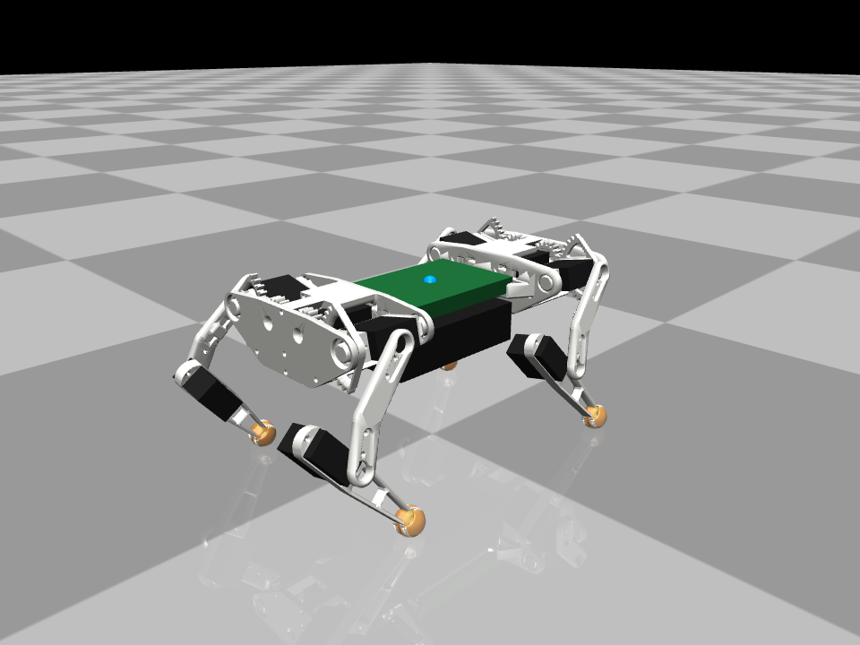
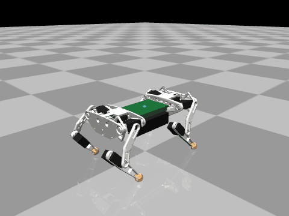
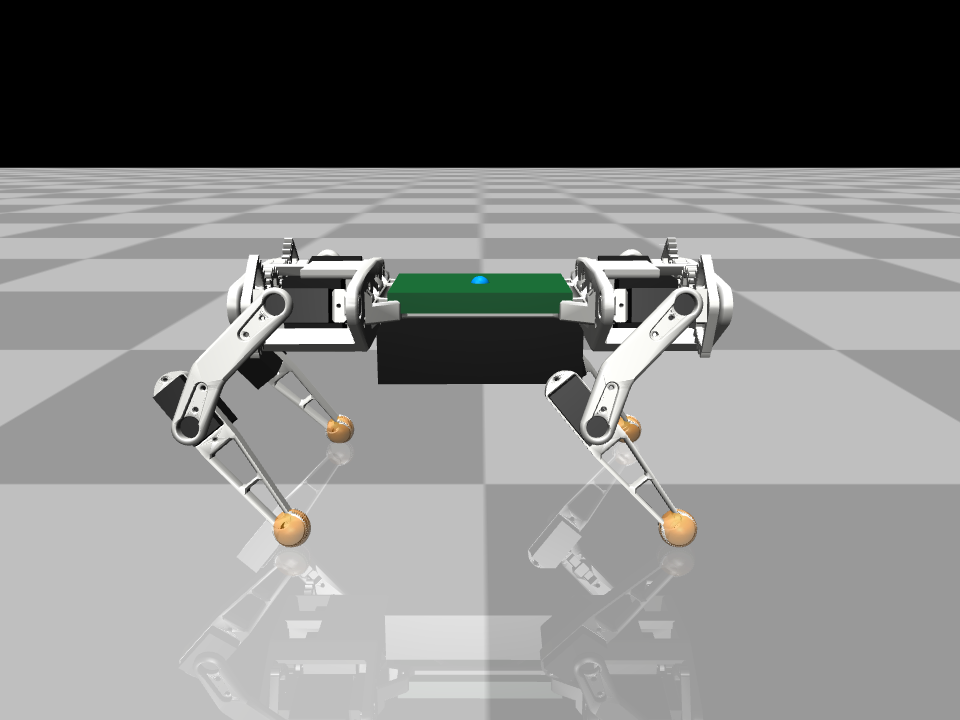
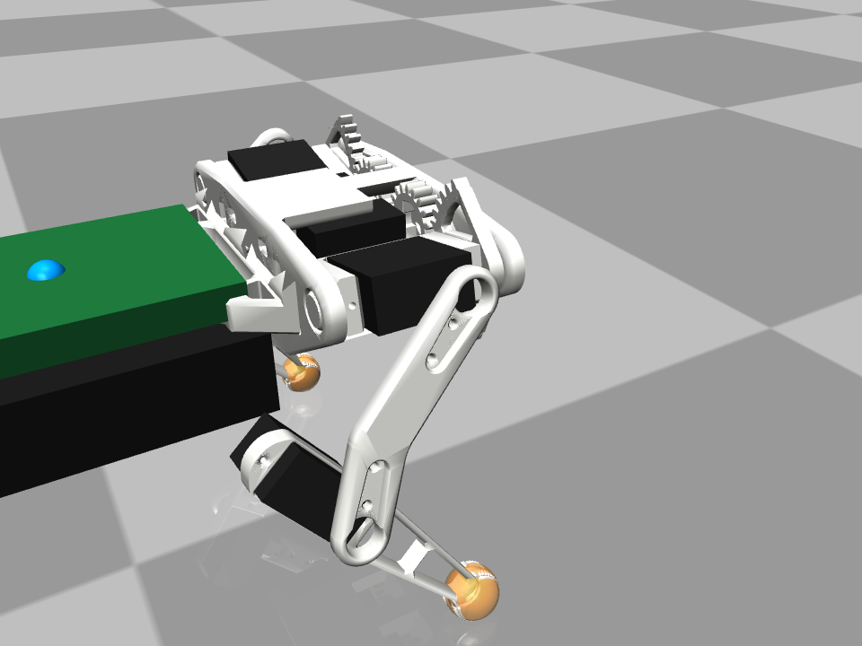
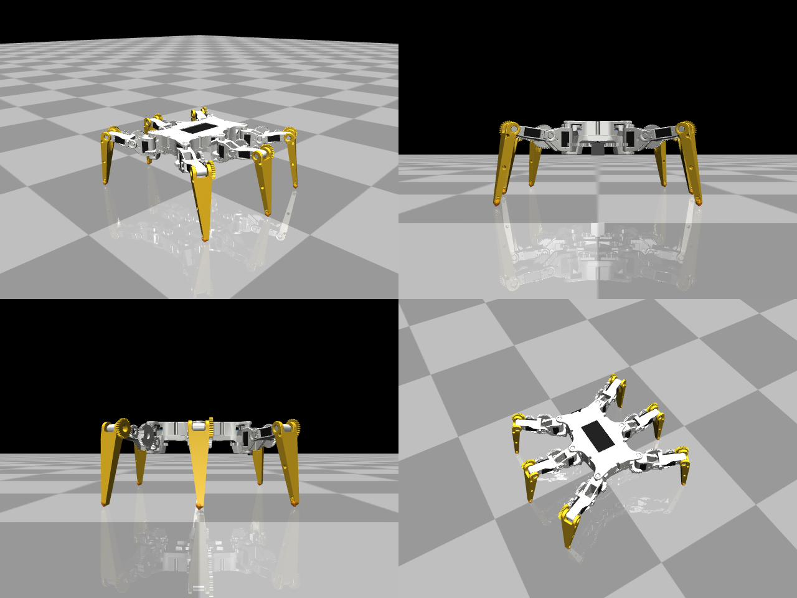
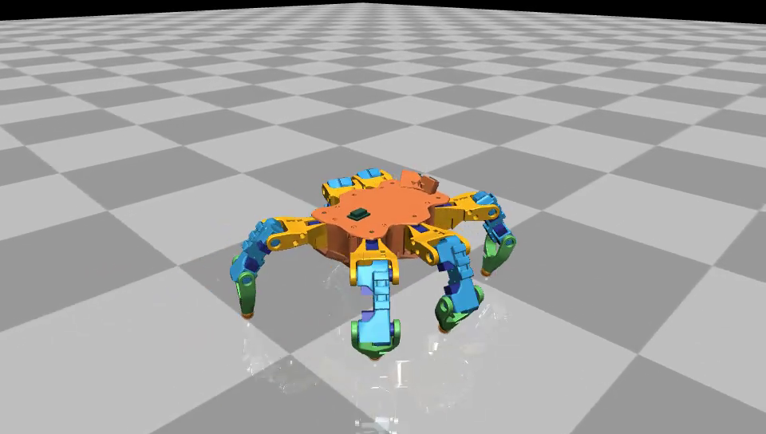

# Robot dog and hexapod physics simulation (MuJoCo)

MuJoCo models of the ESP32 small robot dog and the hexapod for testing motion
code before it goes on the real robots. Python, `pip install -r requirements.txt`.
The hexapod has [its own section](#hexapod) below; everything else is about the dog.

| | |
|---|---|
|  |  |
| Standing in the neutral pose, built from the printed STL parts | Trotting forward, driven by the firmware's own gait and IK (`lib/robot_core`) |
|  |  |
| Side view | Front holder: alpha servo gear and the 2:1 shoulder gear sector, hip-pitch servo in its bracket |

## Quick start

Needs Python 3.9+, a display for the viewer, and a C++17 compiler for the
firmware bridge (built automatically on first use): `g++` on Linux
(`sudo apt install g++`), Xcode command line tools on macOS
(`xcode-select --install`), MinGW-w64 `g++` on Windows (untested; WSL works
like Linux). Set `CXX` to pick another compiler.

On Linux the live examples open their windows on X11 (XWayland on a Wayland
desktop). If the X server refuses the connection ("Authorization required, but
no authorization protocol specified": stale `XAUTHORITY` in tmux/ssh/sudo), they
fall back to Wayland with libdecor off, so GTK isn't loaded (a GTK/GNOME schema
mismatch there aborts Python with a `GLib-GIO-ERROR`), or print how to fix the
display. Details in `legsim/display.py`.

```
git clone -b development https://github.com/SovGVD/esp32-legged-robots-core.git
cd esp32-legged-robots-core/sim
python -m venv .venv
source .venv/bin/activate            # Windows: .venv\Scripts\activate
pip install -r requirements.txt
python -m pytest -q tests            # checks everything works, builds the firmware bridge
python examples/drive.py             # viewer + control window: drive with WASD/arrows or an Xbox pad
python examples/drive.py --hexapod --terrain bridge   # drive over a ramp and a deck with gaps, ToF on
```

`drive.py` runs the real firmware gait (lib/robot_core) on the sim; the
controls are in the table under "Manual control" below. To just look at the
model, run `python -m mujoco.viewer --mjcf models/dog.xml`. Linux and Windows
(macOS isn't supported).

## Commands

```
python -m pytest -q tests            # 88 checks, ~90 s (builds the firmware bridges on first run)
python examples/drive.py             # drive the firmware by keyboard or Xbox 360 pad (needs a display)
python examples/drive.py --nav tof   # live: two rooms, the firmware's map, click it to walk there
python examples/trot.py --view       # Python demo trot in the viewer (needs a display)
python examples/trot.py --video trot.mp4
python examples/snapshot.py dog.png  # still images of the standing robot
python examples/build_model.py       # regenerate models/dog.xml after editing params
```

`models/dog.xml` can also be opened directly in MuJoCo's `simulate` app.

## What is modelled

| Part | Source | Notes |
|---|---|---|
| Geometry: hips at (±39.5, ±70.5, 0) mm, L2 = 51.9, L3 = 50, neutral foot (±56, ±70.5, −80) | `model/dog/model.h`, checked against the STLs | The parts confirm all of these, including the "not sure" hip Y (see below) |
| Hip pitch axis level with the roll axis (`hip_pitch_drop` = 0) | STLs + photos (shoulder bracket) | Same as the firmware IK. The knob stays in `legsim/params.py` to try a misaligned build |
| 3 joints per leg: alpha = hip roll, beta = hip pitch, gamma = knee | firmware IK | Joint angles map 1:1 to firmware leg angles (see below) |
| Masses: torso 280 g, shoulder 20 g (incl. hip-pitch servo), upper leg 3.5 g, lower leg 16.1 g (incl. knee servo); total 438 g | STL volumes + datasheets | Centres of mass and inertias come from the placed STL parts and servo/battery boxes. A scale reading would only be a check |
| MG90D servo: 0.21 N·m stall, 0.10 s/60°, ~4° proportional band, 0.5° deadband, 50 Hz pulse latching, torque-speed line, rotor inertia, gear friction | datasheet + estimates | Hip roll gets the 2:1 gear: twice the torque, half the speed |
| Pulse → angle: `servoMainProfile` calibration table, `getHALAngle` with mid/ratio/inverse | `hal.cpp`, `servo.cpp` | The sim servo is assumed to follow the calibration exactly |
| IMU: accelerometer + gyro at the middle frame, body axes X right / Y forward / Z up | MPU9250 orientation in the IK comments | Optional Gaussian noise |
| Foot contacts: touch sensor per foot | — | Exposed but optional; the real robot has none yet |
| Looks: Gleb's printed parts (STL meshes) plus boxes for servos, battery and electronics | Thingiverse 4822059 | `models/meshes/`, placed by `legsim/assembly.py` |
| Collisions: torso box, battery box, leg capsules, 6 mm foot spheres, friction 0.8 | shoe STL | Hidden (geom group 3); no self collisions |

Every number in `legsim/params.py` is tagged with where it came from: `[code]`, `[stl]`, `[ds]` (datasheet) or `[est]` (guess, tune later).

## Printed parts (STL meshes)

The FreeCAD design (github.com/SovGVD/esp32-small-robot-dog-hardware) has the
parts but no assembly, so `legsim/assembly.py` places them from their
geometry. Each STL's origin turned out to sit on a joint axis:

| Part | What it shows |
|---|---|
| `leg_top` | servo hub holes 51.94 mm apart, exactly L2 |
| `leg_bottom` | knee servo pocket with the shaft ~50 mm from the foot ring, L3 |
| `legs_holder_part1/2` | roll bearings (12 mm) at x = ±39.5 on the roll axis; alpha servo gear at x = ±11 (28.5 mm centre distance, 2:1 with the shoulder sector) |
| `body` | 86.6 mm long; its ends meet the inner holder plates, which puts the hip pitch axis at y = ±70.4, so the "not sure" 70.5 is right |
| `shoulder_part2` | the U bracket lies in the plane of its gear sector and holds the hip-pitch servo centred on the roll axis, shaft pointing outward, so the pitch axis is level with the roll axis |

Estimated, not visible in the parts: where the hip-pitch servo sits in the
bracket (±1.5 mm), how leg_top / knee servo / leg_bottom stack sideways, and
the electronics/battery positions. Left legs use mirrored meshes, and the hind
holders and shoulders are the front ones turned around.

`models/meshes/` holds decimated copies made by `tools/prepare_meshes.py`
from the Thingiverse files (CC BY-NC, by the robot's author).

## Joint convention

The sim joints are zero with the leg straight down, and convert 1:1 to the
firmware's leg angles:

```
q_roll  = pi/2 - alpha   (+ = foot outward)
q_pitch = pi/2 - beta    (+ = upper leg backward)
q_knee  = pi   - gamma   (0 = straight leg)
```

`tests/test_kinematics.py` checks this both ways: a Python port of
`QuadrupedLegIK` is fed foot targets, and the MuJoCo model's feet land exactly
on them. It also round-trips leg angle → pulse → leg angle through the HAL for
all four legs with their `inverse` flags.

## Interfaces (for the firmware bridge)

`legsim.SimDog` exposes the robot the way the hardware layer sees it:

| Firmware side | SimDog |
|---|---|
| servo bus: pulse per channel (`leg*3 + joint`), 0 = off | `write_pulse(ch, us)`, `write_pulses(us[12])` |
| IMU: accel + gyro | `read_imu()` → `{"accel": m/s², "gyro": rad/s}` |
| contact sensors (optional, future) | `foot_contacts()` |
| loop timing | `step(seconds)`; firmware `LOOP_TIME` is 4.4 ms |

Plus helpers: `set_leg_angles()` (runs the HAL like `runServoHAL`),
`set_feet()` (Python IK port → HAL), `set_joint_targets()`, and ground truth
(`body_position_mm()`, `body_orientation()` in the firmware's pitch/roll/yaw
convention, `foot_positions_body_mm()`).

## Running the firmware in the sim

`legsim.FirmwareCore` runs the firmware's own motion code: `lib/robot_core`
(`MotionController`: GaitEngine, BodyKinematics, QuadrupedLegIK, plus the
servo HAL) with the dog's legs, servo profile and gait parameters from
`src/esp32-legged-robot/model/dog/model_data.h`. It is compiled with the host
C++ compiler into `sim/build/librobot_core_bridge.so` (`sim/bridge/`), rebuilt
automatically when any of those sources change, and called through ctypes.

```python
from legsim import SimDog, FirmwareCore
dog, fw = SimDog(), FirmwareCore()
fw.drive(dog, (0, 1, 0, 0, 0, 0), duration=3.0)   # forward at full speed for 3 s
```

Each tick is `rc_update(dt, command, imu) -> pulses[12]`, the same as
`updateMotion()` + `servoSet()` on the robot, then `SimDog.write_pulses()`.
The command is `LR_moveVector`: move x (+ right), y (+ forward), z, rotate
pitch, roll, yaw (+ turns right), each in [-1, 1], like the web client.
The IMU reading is the simulated accelerometer and gyro run through the
firmware's own `TiltEstimator` (`fw.imu_angles(dog)`); it feeds the IMU
leveler, which is off unless `fw.set_leveling(True)` (or the model's
`HORIZON_LEVEL`).
`fw.select_gait("walk")` picks the dog's statically stable walk
(`GAIT_PARAMS_WALK`), `fw.support_margin()` reports how far the centre of
mass is inside the support polygon, and `fw.tune_gait(...)` /
`fw.set_stability_gain(...)` change timing and shift for experiments.

`tests/test_firmware.py` checks that the C++ IK + HAL produce the same
pulses as the Python port, that the firmware stands, trots, strafes,
turns and stops in the sim, and that the static walk keeps the centre of
mass inside the triangle and tilts less than the same walk without the
shift, and that leveling takes out most of an 8° slope (gravity tilted)
without rocking the robot on flat ground.

### Manual control

```
python examples/drive.py                                  # dog, flat floor
python examples/drive.py --hexapod                        # hexapod
python examples/drive.py --terrain rubble                 # rough gait, foot switches + ToF map
python examples/drive.py --hexapod --terrain gaps --sensing tof
python examples/drive.py --terrain bridge --sensing none  # open loop, like the real robots today
```

`--terrain` takes any scene from "Rough ground" below (flat, bumps, rocks,
rubble, bars, step, drop, gaps, bridge, course), `--height` the obstacle
height, `--sensing` none / contacts / tof / both (default both with a
terrain), `--gait` the starting gait (rough with a terrain). The ToF sensors
show as purple boxes with orange view cones and blue zone hits, and the
control window says "GAP AHEAD: stopped" while the robot waits at a gap it
can't step over (let go of the stick or steer away).

`python examples/drive.py` opens the MuJoCo viewer and a small "robot
control" window (`pip install pygame-ce`; if plain `pygame` is also installed, `pip uninstall pygame` first, they share the `pygame` module). Focus that window for the keyboard:

| Keyboard | Xbox 360 pad | Action |
|---|---|---|
| W / S, Up / Down | left stick up / down | forward / back |
| A / D | left stick left / right | strafe |
| Q / E, Left / Right | right stick X | turn |
| I / K, J / L | hold LB + right stick | tilt body (pitch, roll) |
| Shift | | slow (40 %) |
| G | Y | switch gait while standing: trot / static walk / rough (hexapod: tripod / rough) |
| R | Back | reset robot |
| P | Start | pause |
| Esc | | quit |

Keyboard and pad add up. Any pad SDL knows as a game controller works
(Xbox 360/One, most others). Linux and Windows.

### Dog stance width

`FirmwareCore.set_stance(x)` (and `lidar_nav.py --stance-x`) tries other neutral foot widths
(config.h `LEG_POINT_X`; the hip roll axes are 39.5 mm out). Sweep, 2026-11-05 (trot at full
stick, ToF terrain walks, a 0.1 s sideways push while trotting in place):

| feet out, mm | push that tips it | 20 mm step (1.0 / 0.8 speed) | trot roll p2p, deg |
|---|---|---|---|
| 39.5 (legs vertical) | 4 N | stuck / stuck | 4.4 |
| 50 | 5 N | ok / ok | 2.9 |
| 56 (old) | 6 N | ok / ok | 3.8 |
| 60 | 8 N | ok / stuck | 4.0 |
| 64 (new) | 10 N | ok / ok (447 mm) | 4.4 |
| 68 | > 10 N | ok / ok | 2.0 |
| 74-80 | > 10 N | stuck / stuck | 3 |

Speeds (150 mm/s forward, 50 sideways, 33 deg/s turning) and servo loads barely change.
Vertical legs fail the step (the front feet reach the edge and the body pitches); over ~70 mm
the same. 64 mm is the middle of the range that climbs, with most of the push margin.
Gaps (30 / 40 mm) vary run to run at every width.

## Hardware in the loop: a real ESP32 as the brain

The ESP32 runs the whole firmware (motion task at its own rate, WiFi AP, web
UI, CLI, failsafe, battery protection, ToF map, room scans, navigation),
while the servos, IMU, battery, ToF sensors and foot switches are this
simulation, over the USB cable. Any ESP32 board works, with nothing connected
to it.

```
pio run -e robot-dog-hil -t upload           # or robot-hexapod-hil
pip install pyserial pygame-ce
python examples/hil.py --port /dev/ttyUSB0   # Windows: --port COM5
python examples/hil.py --port /dev/ttyUSB0 --rooms              # map + tap to walk on the phone
python examples/hil.py --port /dev/ttyUSB0 --terrain bridge     # foot switches: CLI `feet on`
python examples/hil.py --fake                                    # no board, to try the window
```

Drive it from the web UI: join the board's WiFi (SmallDogV1 / 1234567890 by
default), open http://192.168.1.1. Or from the PC: the "robot control"
window takes the keyboard / gamepad like `drive.py` and sends move commands
over the cable (they feed the failsafe; let go and the web UI has it again).
`R` puts the robot back on its feet. The board's serial text is printed in
the terminal; CLI `hil` (web UI CLI tab) shows the link from the board's side.

How it works (`lib/robot_core/src/hil_link.h`, `src/esp32-legged-robot/hil.cpp`,
`legsim/hil.py`): the HIL build (`-DHIL`) swaps the device drivers for ones
that talk to the PC (servo bus, IMU, power sensor, ToF array, foot input,
the interfaces in `hardware.h`). Every motion tick the board sends its pulses
and the time the tick took, the sim steps that long and answers with the
accelerometer, gyro, magnetometer, foot switches and battery; ToF frames at
15 Hz. So the board's own timer is the clock, and the sensors are a tick old
like a real I2C read. The IMU readings go through the same TiltEstimator /
HeadingEstimator as on the robot. Frames have a CRC, the firmware's text
goes between them, 921600 baud (`HIL_BAUD`).

| | |
|---|---|
| Simulated | servos (pulses -> the sim's servo model), MPU9250 accel / gyro (+0.5 deg/s drift, `--gyro-bias`), AK8963 magnetometer (`--no-mag`), INA219 battery voltage (`--battery`, constant), VL53L5CX frames, a microswitch under every foot (the dog too) |
| Not simulated | the LD06 lidar (HIL builds use the ToF room scans), the camera, battery drain and current |
| Kept apart | the HIL build stores its settings in NVS namespace `robot_hil`, so flashing the robot's own ESP32 doesn't touch its servo trims (the sim needs none) |

If the PC can't keep up, the sim runs slower than real time ("sim/wall" in
the window < 1); a PC does ~800 dog / ~430 hexapod ticks a second, the board
sends 227 / 143.

## Hexapod

| | |
|---|---|
|  |  |
| Neutral stance (simple shapes: no CAD yet) | Walking forward, driven by the firmware's own gait and `HexapodLegIK` |

The 2026-11 design ("Recommended" in the body study), not built yet: hexagon
body, coxa / femur / tibia 60 / 50 / 60 mm, 18 MG90S straight on the joints
(no gears), 2x 18650 at the bottom centre, a PCA9685 + 3 Mini360 board along
each side, the ESP32 across the front, GY-91 under the top cover, two VL53L5CX
at the front (+-20 deg), switch feet, ~1105 g. The front legs open 20 deg
wider than the others so the ToFs see past them. The old geared hexapod
(STL parts, 35 / 55 / 110 legs) is gone from the firmware and the sim.

```
python examples/drive.py --hexapod             # drive it by keyboard / Xbox pad (needs a display)
python examples/drive.py --hexapod --terrain rubble
python examples/drive.py --hexapod --nav tof   # rooms, click the map to walk there
python examples/hexapod_walk.py                # scripted walk, prints distance, tilt, servo load
python examples/hexapod_legtest.py             # the leg-by-leg direction test (--video, --view, --leg RF)
python examples/hexapod_servo_compare.py       # MG90S 5 / 6 V vs PTK 7465MG
python -m pytest -q tests/test_hexapod.py
```

In code:

```python
from legsim import FirmwareCore
from legsim.hexapod import SimHexapod
fw = FirmwareCore(model="hexapod")             # builds sim/build/librobot_core_bridge_hexapod.so
robot = fw.place(SimHexapod())
fw.drive(robot, (0, 1, 0, 0, 0, 0), duration=3.0)   # forward, full speed, 3 s
```

`SimHexapod` has the same interface as `SimDog` (`write_pulses`, `read_imu`,
`set_leg_angles`, `set_feet`, ground truth) with 18 channels, `leg*3 + joint`
in the firmware leg order LF, LM, LR, RF, RM, RR (not the PCA9685 channel).
`joint_torque_ratio()` says how close each servo is to stall.

| Part | Source | Notes |
|---|---|---|
| Coxa axes at (+-35, +-58) and (+-45, 0) mm; coxa 60, femur 50, tibia 60; neutral feet 69 mm out from the coxa axis, 100 mm down | `model/hexapod/config.h` (design) | Femur ~58 deg down at rest: the foot is nearly under the femur axis |
| Body: hexagon plates 14 mm past the coxa axes, 28 mm under and 16 mm over the femur axis | design concept | `legsim/hexapod/simple_parts.py`: boxes and cylinders |
| MG90S at 5 V: 1.87 kg cm stall, 0.093 s/60 deg | datasheet (1.8 @ 4.8 V, 2.2 @ 6 V) | Not measured; clones are often weaker |
| Pulse -> angle: 500-2500 us over 0-180 deg | `model_data.h` | Linear until measured |
| Masses: 1105 g | prints from `cad/hexapod` (solid PLA), the rest a design estimate | Per leg: coxa 45.5, femur 47.1, tibia 16.9 g (servos 13.4 g each; the femur carries 2) |
| Servo directions | the inverse flags (right legs mirrored) | Nothing to check against until it is built |

What the sim says (`tests/test_hexapod.py`):

* Standing: femur servos at ~5 % of stall, tibia ~12 %.
* Tripod, 0.3 s cycle: ~250 mm/s forward with the servos at their torque limit
  ~2 % of the time; ~130 mm/s sideways; ~1.5 rad/s (86 deg/s) turning. 400 mm/s asked
  walks ~380 but the femur servos saturate 38 % of the time.
* Room scans: the right ToF looks 22 deg down. With both at 35 deg the scan
  needs the nose ~18 deg up and the legs only give ~11.

### Servo directions (leg test)

`examples/hexapod_legtest.py` hangs the robot in the air and, one leg at a
time, moves the foot up, out, forward and turns the leg around its coxa
through the firmware's own IK and HAL (`FirmwareCore.leg_test_pulses`). It
prints OK/WRONG per move, the joints that turned against the IK's plan and
the flags to flip. In the sim each servo turns the way `SimHexapod.direction`
says, taken from the flags; flip an entry to see what a servo mounted the
other way does. Run the same moves on the robot once it is built.

### What-if: other servos

`examples/hexapod_servo_compare.py` runs the firmware tripod with the MG90S at
5 and 6 V and with PTK 7465MG servos (`ptk_7465mg(volts, frame_hz)`, datasheet
torque and speed at 5.0-8.4 V, up to 333 Hz frames).

`tools/hexapod_leg_sizing.py` is a quick static check for a leg shape (coxa /
femur / tibia lengths, foot reach and height, mass): femur and tibia load as a
share of MG90S stall with 3 feet down at the worst point of the stride, and
how far the centre of mass is inside the tripod. It is a slippery-floor worst
case. `tools/hexapod_leg_sweep.py` searches shapes against load, stability,
clearance, lift and speed.

## Rough ground: foot switches and ToF sensors

```
python examples/terrain_walk.py                              # dog, obstacle course, foot switches + ToF
python examples/terrain_walk.py --hexapod --terrain step --sensing tof
python examples/terrain_walk.py --hexapod --terrain bridge --sensing tof    # ramp, deck with gaps, ramp down
python examples/terrain_walk.py --compare                    # every scene x sensing mode, a table
python examples/terrain_walk.py --hexapod --terrain bars --video bars.mp4   # ToF sensors as purple boxes, view cones orange, zone hits blue dots
python -m pytest -q tests/test_terrain.py
```

The terrain code is firmware code (`lib/robot_core`), off unless enabled,
so the real robots keep walking open loop until sensors are fitted:

* **Foot switches** (`GaitParams.useContactSensors`, `leg.sensor.onGround`):
  a foot that hasn't touched down when its swing time is over keeps
  reaching down (`searchDepth`), a foot that touches down early stays there,
  and a standing foot whose switch opens (slid off an edge) reaches down
  again. Each leg remembers the height it stood on and aims its next step there.
* **ToF terrain map** (`TerrainMap`, `TOF_SENSORS` in `model_data.h`): each
  zone of a multizone ToF (VL53L5CX 8x8, or a VL53L1X with ROI zones) is a ray
  from the sensor; its hit goes into a 40x40 height grid around the robot in
  the gait's odometry frame (dog: 12 mm cells, hexapod: 15 mm). A swing aims
  at the mapped height of its foothold, goes up first and then across, at
  least `clearance` above the highest mapped point on its way, and a foothold
  on an edge moves along the step onto flat ground.
* The **body height** follows the average ground under the feet, and the
  **IMU leveler** keeps the body level: in terrain mode the bridge doesn't
  hold it during a trot, and the scenarios turn leveling on with any sensing.
  The unplanned body tilt (IMU) also corrects the measured touchdown heights
  (`GaitEngine::setTilt`).
* **Gaps**: a foothold keeps `gapMargin` (20 mm) away from ground that drops
  away (lower than its own by more than `maxStep`) and from unseen cells
  between known ground (the ToF can't see into a narrow trench or under a
  cliff edge, it sees the far wall). A foothold in a gap moves along the step
  (`footholdShift`) onto solid ground. When there is none, and none further
  on within one step either, the gap is too wide: the swing puts the foot back
  where it lifted off and the gait blocks the command in that direction
  (`GaitEngine::isBlocked()`, `blockedDirection()`) until the stick stops
  pushing that way. Turning or walking back works while blocked.
* **Map pose**: the body tilt the map uses matters at a gap edge (1 deg is
  4 mm at 250 mm). Hexapod: the leveler's commanded tilt plus the IMU's
  unplanned tilt with the slow walking bias (1-2 deg, 1.5 s filter) taken
  out and smoothed over 0.3 s; with the raw IMU its mapped floor crept up
  10-20 mm in 10 s of walking (the leveler follows the bias) and it stepped
  onto nothing. Dog: the raw IMU; its trot rocks faster than that filter and
  the filtered tilt cost it the 20 mm step. Cells age only while walking, so
  a robot standing at a gap still remembers it. (`rc_set_map_tilt_mode` in the
  bridge switches it for experiments.)
* Not wired on the robots yet: `motion.cpp` doesn't read switch pins or a ToF
  driver, so nothing changes on hardware. When sensors are fitted it needs to
  set `leg.sensor.onGround`, feed `TerrainMap::addReading` with the map pose
  above, tick the map only while the gait is active, call
  `gait().setTerrain(...)` / `setTilt(...)`, not hold the leveler, and show
  `isBlocked()` to the operator (telemetry / web UI), the way
  `sim/bridge/robot_core_bridge.cpp` does.
* `GAIT_PARAMS_ROUGH` (dog and hexapod): a slower gait with a longer swing.
  The servos can't lift a foot 30-40 mm in the normal 100-150 ms swing; the
  foot lags and hits the edge.

`TERRAIN_PARAMS` and `TERRAIN_MAP_PARAMS` in each `model_data.h` hold the
numbers. Sensor mounts (simulated, nothing is fitted yet): dog, one 8x8 ToF on
the nose looking 25 deg down; hexapod, two on the front turned 20 deg left and
right, the left 35 deg down, the right 22 deg (flatter for the room scans, see
"ToF room scans"; until PR #25 the dog's was 40 deg and both hexapod ones 35).

In the sim (`legsim/terrain.py`, `legsim/tof.py`): obstacles are static boxes
(bumps, rocks, rubble, bars, step, drop = walk off a platform); a foot switch is
pressed when the ground pushes the foot up with more than 0.3 N (vertical
part only, so pushing against the side of an obstacle doesn't press it); the
ToF casts one ray per zone at 15 Hz with 2 mm + 1 % noise against the
terrain (not the robot). `FirmwareCore.set_terrain(contacts, tof)` switches
the modes, and `legsim.scenario.run()` walks a robot over a scene and
measures it.

Findings (rough gait, full stick, 8 s dog / 6 s hexapod; `--compare`):

| | open loop | switches | ToF | both |
|---|---|---|---|---|
| Dog, 20 mm step | stuck at the edge, 127 mm | 310 mm | **641 mm, up** | **705 mm, up** |
| Dog, 10 + 20 mm bars | 434 mm | 452 mm | **696 mm** | 425 mm |
| Dog, 12 mm bumps | 612 mm, tilt 2.1 deg | 683, 4.2 | 678, 3.2 | 659, 2.3 |
| Hexapod, 30 mm step | 548 mm, tilt 2.8 deg | 414, 3.7 | **686, 0.8** | **690, 0.9** |
| Hexapod, 15 + 30 mm bars | 462 mm | 500 | **627** | **668** |
| Hexapod, 18 mm bumps | 674 mm, tilt 1.4 | 677, 1.5 | 701, 1.2 | 703, 1.6 |
| Hexapod, 22 mm drop | 689 mm, tilt 2.1 | 680, 2.9 | 683, 1.1 | 694, 1.4 |
| Dog, rubble up to 20 mm | 556 mm, tilt 2.7 | 610, 4.3 | 560, 4.2 | 564, 4.4 |
| Hexapod, rubble up to 30 mm | 683 mm, tilt 1.4 | 653, 1.2 | 696, 1.4 | 666, 1.4 |

* The ToF map does most of the work: with it the dog climbs a 20 mm step its
  open-loop trot can't, and the hexapod walks up 30 mm level instead of
  stumbling up it.
* Foot switches alone can only feel an obstacle after hitting it. They help
  on small bumps and holes, not on anything taller than the step height; on
  the dog's trot (two legs down) they add some rocking.
* Dense rubble (`rubble()`: overlapping blocks 10-80 mm across, mixed
  heights, about half the ground covered) gains little from sensing: the
  rough gait's step height already clears most of it, and the blocks are
  smaller than the map can resolve well. The hexapod
  walks it the same in every mode (with fewer leg knocks with ToF); the dog,
  at its height limit, rocks more with sensing (mean tilt ~4 deg vs 2.7).
  Lowering the swing on high legs (apex over the mean ground) helped here but
  broke the step climb, so it is not in.
  `FirmwareCore.tune_terrain(...)` changes `TERRAIN_PARAMS` for experiments.
* Limits: the hexapod's femur servos (45 deg each way, 2:1 gear) run out
  above ~30 mm obstacles, the dog's legs (80 mm, reach 102) around 20 mm.
  Higher needs a taller stance or longer legs, not more sensing.
* **Gaps and the bridge** (`gaps()`: trenches in a raised floor, narrow to
  too wide; `bridge()`: a ramp up onto a narrow deck with gaps, a ramp down;
  ToF, 3 runs each, `scenario.run(..., steer=True)` on the bridge):

  | | open loop | ToF |
  |---|---|---|
  | Hexapod, 40 mm gap | a foot falls in, tilt ~28 deg | **steps over, tilt 4 deg, 3/3** |
  | Hexapod, 60 mm gap | falls in | steps over 2/3 (one run tilts 25 deg) |
  | Hexapod, 90 mm gap | falls in | stops at the edge 1/3, a foot catches the edge the other times |
  | Hexapod, 250 mm gap | falls in | **stops at the edge** (test) |
  | Hexapod, bridge (40 + 55 mm gaps) | falls in, tilt 29 deg | crosses, 1170 mm; 2/3 runs tilt over 20 deg once |
  | Dog, 25 mm gap | falls in | gets across 1/3, tips a leg in 2/3 |
  | Dog, 40 mm gap | falls in | stops at the edge, tips a leg in 2/3 |
  | Dog, 60 mm gap | falls in | **stops at the edge, 3/3** |
  | Dog, bridge (25 + 35 mm gaps) | falls in | gets onto the deck (970 mm), tips over 20 deg in 2/3 |

  The hexapod (three feet down, slow tripod) handles gaps; the dog's trot
  (two feet down) is fragile at an edge: its odometry slips 20-40 mm per
  metre, so the map is that far off, and one misplaced foot tips it.
  Gaps narrower than two map cells (dog 24 mm, hexapod 30 mm) are hard to
  see; the feet step over them or onto the edge.
* **Heading**: `FirmwareCore.set_heading_sensors(gyro_bias_dps, magnetometer)` feeds the
  firmware's `HeadingEstimator` (gyro yaw rate with a bias, magnetometer from the sim's
  orientation and an earth field, world +Y = north); `heading_hold()`, `turn_to(deg)`,
  `heading_state()` are the CLI's `heading on`, `turnto`, `heading state`. A push that turns
  the walking dog 60 deg: without the hold it walks off that way, with it it turns back to
  within 5 deg (`tests/test_firmware.py`). Videos: `examples/sensor_videos.py`.
* Odometry: the map lives in the gait's odometry frame. When a foot gets
  stuck the robot falls behind its odometry and the map slides with it;
  cells are forgotten after `maxAge` (dog 10 s, hexapod 6 s).

## Lidar: indoor map and walking to a point

`FirmwareCore.set_lidar(True)` puts a simulated LD06 on the robot (`legsim/lidar.py`,
mount from `LIDAR_PARAMS` in `model_data.h`): 10 rev/s, 4500 points/s, each point cast
from where the lidar is at that moment (a walking, turning, rocking robot skews the scan
like the real one), ~10 mm + 1 % noise, packed into real LD06 packets (CRC-8) and fed to the
firmware's own driver as UART bytes. The firmware code (`lib/robot_core` `lidar`,
`lidar_slam`, `navigator`) parses them, builds the map, corrects the odometry and plans;
`nav_goal(x, y)` is the CLI's `goto` (mm), `nav_state()`, `nav_path()`, `lidar_pose()`
(map and odometry pose), `lidar_map()` read it back. The scene `terrain.rooms()` is two rooms
joined by an 80 cm doorway, with a sofa, a cabinet, table legs and boxes.

    python examples/drive.py --nav lidar              # live: viewer + map window, click the map to walk there
    python examples/lidar_nav.py                      # dog: three goals, through the door and back
    python examples/lidar_nav.py --model hexapod
    MUJOCO_GL=glfw xvfb-run -a python examples/lidar_nav.py --video out/dog-lidar.mp4 --png out/map.png

Results (gyro drifting 1 deg/s, no magnetometer: indoors it is thrown off by steel and wiring;
10 cm map cells):

| robot   | goal              | reached | lidar pose error | odometry only   |
|---------|-------------------|---------|------------------|-----------------|
| dog     | (-0.7, 3.0) m     | 35 s    | 24 mm, 0.6 deg   | 304 mm, 0.1 deg |
| dog     | (1.1, 2.9) m      | 17 s    | 26 mm, 0.5 deg   | 326 mm, 0.5 deg |
| dog     | back to (0.3, 0)  | 27 s    | 72 mm, 0.0 deg   | 64 mm, 1.3 deg  |
| hexapod | (-0.9, 3.9) m     | 38 s    | 87 mm, 0.1 deg   | 121 mm, 0.8 deg |
| hexapod | (1.3, 3.7) m      | 17 s    | 78 mm, 0.0 deg   | 155 mm, 0.9 deg |
| hexapod | back to (0.5, 0)  | 27 s    | 58 mm, 0.2 deg   | 139 mm, 1.0 deg |

With the lidar the pose stays within a few cm; the remaining error is mostly the map cells
(the matcher pulls points toward cell centres, up to half a cell). No rejected scans, no CRC
errors. The odometry alone drifts a few cm per metre here, but the sim's feet don't slip like
real ones and the gyro's bias is learned while standing (`Odometry2D`): on the robot expect
worse. (The sim gyro reports the mean turn rate of each tick, like an IMU behind its low-pass
filter; the instantaneous rate sampled once a tick aliased with the foot impacts and read
2-3 % short over a turn.) Limits: the map is 20 x 20 m around the start, the planner sees
10 x 10 m of it around the robot and the goal at a time, no loop closure (a long loop through
several rooms can come back a little off), things below the scan plane are invisible to it,
and moving people leave marks that fade as the lidar sees through them again. Tests:
`tests/test_lidar.py`, `test/test_lidar` (native).

## ToF room scans: the same map without a lidar

`FirmwareCore.set_tof_nav(True)` feeds the map from the terrain ToF sensors instead
(`tof_scan.h`, `TofNavigator`): to scan, the robot stops, tilts its nose up (and crouches 15 mm,
the legs reach further), turns once around at ~0.45 rad/s and puts every zone ray within 4 deg
of level that hit something higher than 4 cm above the floor into a 360 deg scan (one point per
degree, odometry of the frame's moment), which goes into the same `LidarSlam` matcher and map.
Walking to a goal it scans first, then every metre. The simulated VL53L5CX reports the closest
target of 2 x 2 rays per zone, out to 3 m, ~40 ms late. `set_tof_mount(i, deg)` and
`tune_tof_scan(...)` try other mounts and scan settings.

    python examples/drive.py --nav tof                                          # live: click the map, N scans, X stops
    python examples/drive.py --hexapod --nav tof --mount 40 --scan-tilt 15      # live, the old mount
    python examples/lidar_nav.py --tof                                          # dog, three goals, prints the result
    python examples/lidar_nav.py --tof --model hexapod
    python examples/lidar_nav.py --tof --mount 40 --scan-tilt 15                # the old, steeper mount
    MUJOCO_GL=glfw xvfb-run -a python examples/lidar_nav.py --tof --video out/dog-tof.mp4 --speedup 6
    python examples/drive.py --hexapod --nav tof --mount 35 --sensor-servo 18   # live, ToFs on a tilt servo
    python examples/lidar_nav.py --tof --model hexapod --mount 35 --sensor-servo 18 --log

**Sensor tilt servo** (`TofScanParams.sensorServo`, sim only so far, the firmware doesn't drive
a servo yet): one small servo tilts both ToF sensors up `tilt` for a room scan instead of the
body, which stays level (with the crouch: the hexapod turns faster lower). Both sensors can
then look 35 deg down for footholds and 17 deg for walls. Hexapod, three seeds, three goals:
all arrived, 0 rejected scans, heading error at the scans ~1.2 deg (2.8 with the 18 deg body
tilt it would otherwise need, which the IMU's tilt estimate doesn't follow well while turning).
Terrain tests about the same as the 35 / 22 mount (the 40 mm gap is still not crossed).

**Doubtful walls** (`NAV_PARAMS` doubtful = 40 log-odds): a map cell hit by only one scan from
afar (often a doorway seen at a slant) doesn't block the planner, it costs more. When the path
crosses one 300-700 mm ahead, the robot stops and scans there first: a wall gets confirmed and
the planner goes around, a doorway gets cleared. `lidar_nav.py --floor 30` puts drive.py's rug,
threshold, platform and tiles in the rooms. With them the hexapod (walking open loop, 30 mm
steps) caught its feet on the platform edge and got lost in about half the runs; it now stops at
anything over 25 mm (`obstacleHeight`) and maps a strip as wide as itself: 0 rejected scans
in 6 runs, 15 of 18 goals reached (the misses: ~0.2-1.9 m short of the goal behind the platform
at timeout). The dog with the floor objects and ToF terrain sensing still gets lost in 2 of 3
runs (not fixed yet).

The legs can tilt the dog's nose up ~15 deg (with the crouch; 20 deg runs the legs out of reach)
and the hexapod's ~10 deg (servo ranges). The sensors' top zone row looks 19.7 +- 2.8 deg above
their axis, and a zone reports the floor under its lower edge before a wall further away, so the
lower edge has to look level: nose up = mount angle - 17 deg. With the old mounts (dog 40 deg,
hexapod 35 deg down) that is out of reach, walls beyond ~1 m are lost and the robots got lost
(dog 1 of 3 goals, ~1 m off; hexapod none); dog 30 / hexapod 27 deg (nose up 13 / 10, the legs'
limit) got lost too. So `TOF_SENSORS` now has the dog's sensor 25 deg down and the hexapod's
right one 22 deg (the left stays 35 for terrain):

| robot (mount)    | goal              | reached | map pose error   | odometry only    |
|------------------|-------------------|---------|------------------|------------------|
| dog (25 deg)     | (-0.7, 3.0) m     | 230 s   | 125 mm, 4.5 deg  | 1325 mm, 39 deg  |
| dog              | (1.1, 2.9) m      | 48 s    | 127 mm, 3.1 deg  | 1773 mm, 45 deg  |
| dog              | back to (0.3, 0)  | 74 s    | 90 mm, 2.9 deg   | 1527 mm, 58 deg  |
| hexapod (35+22)  | (-0.9, 3.9) m     | 179 s   | 350 mm, 6 deg    | 292 mm, 10 deg   |
| hexapod          | (1.3, 3.7) m      | 51 s    | 357 mm, 7 deg    | 370 mm, 12 deg   |
| hexapod          | back to (0.5, 0)  | 94 s    | 259 mm, 11 deg   | 640 mm, 16 deg   |

Every goal is reached, slowly (each scan is ~16 s standing and turning; the first goal is behind
a wall the robot hasn't seen, it walks into the corner first). The dog's odometry suffers from the
scan turns (a few degrees off per turn), which the scans then correct. The hexapod's map pose is
~30 cm off, about what its odometry alone is: the sparse scans hardly improve on it at 10 cm
cells (with 5 cm cells it was 1-10 cm). With only its right sensor scanning, half its scans are
rejected and the heading is 6-11 deg off (with both at 22 deg: under 2 deg). What the flatter mounts cost on rough ground (`terrain_walk.py`, ToF sensing, 25 vs 40 deg):
the dog still climbs the step, bars and rubble and walks as far or further (step 317 vs 268 mm,
rubble 706 vs 641), but its body brushes the obstacles more often (step 31 vs 0 ticks, bars 40
vs 0). The dog's gap runs are poor at either angle. Both hexapod sensors at 22 deg walked into 70 mm
gaps (324 vs 700 mm in the test), hence the mixed mount, which crosses them and climbs the 30 mm
step (695 vs 674 mm, a few footholds out of reach).
Tests: `tests/test_lidar.py` (ToF room scans), `tests/test_terrain.py`, `test/test_tof_scan` (native).


### Nav with terrain sensing

The same ToF sensors can feed the terrain map and the room scans at once (`terrain on` plus a
goal on the robot; `--nav tof --sensing tof` in `drive.py`). What works:

* The room scan with terrain sensing on (`tests/test_lidar.py::test_tof_room_scan_with_terrain_sensing_on`).
  Two fixes made that possible. The terrain map pauses during a scan (the hexapod can't fully
  reach the nose up, and the map placed readings for a tilt the body didn't have). And the IMU tilt
  filter (`TiltEstimator`) no longer makes up a tilt when the robot turns with its nose up: it
  integrated the tilted gyro's X/Y rates, which a turn about the vertical shows on too, and
  invented ~4 deg of sideways lean. That one matters on the real robots whenever they turn while tilted.
* A gap the terrain code stops at goes into the nav map (`TofNavigator::gapAhead`) and the path
  goes around it.
* `terrain.rooms(floor=20)`: a rug, a door threshold, a low platform and uneven tiles.

* Walking to goals with terrain sensing on: the dog reaches all three goals in the rooms, plain
  and with `floor=20` (`tests/test_lidar.py::test_dog_walks_to_a_goal_with_terrain_sensing_on`,
  and `drive.py --nav tof`, where terrain sensing is now the dog's default). Before, the terrain
  map crept up on long walks and the robots stepped onto ground that isn't there. Three causes,
  three fixes (none needs new hardware):
  * The IMU's tilt is 1-2 deg off while the robot trots, so the floor ahead was mapped a little
    high, a few mm a step. A frame that sees mostly one plane now uses that floor's own tilt
    (`TerrainMap::floorTilt`, `FrameTilt`); frames that don't (a step, an obstacle) use the IMU's
    plus the last offset. The dog's mapped floor stays at 0 mm over a 40 s walk
    (`tests/test_terrain.py::test_terrain_map_stays_on_the_floor_on_a_long_walk`).
  * Without foot switches the body is only planned to be at its height: where the feet land short
    (a platform edge), it is lower, the next frame mapped the ground higher, the body followed it
    up, and so on. Each frame is now lined up with the heights the map already has (median
    over the overlapping cells, `TerrainMap::frameOffset`, 2 mm deadband).
  * Walls and furniture: the ToF hits their faces low and high, and the feet took the low hits as
    steps and climbed the wall. A cell hit at heights more than 3 x `jump` apart is now a vertical
    face (`TerrainMap::isFace`), never a foothold; its height still updates as before (a gap's
    bottom must stay low for the gap checks).

What doesn't yet: the hexapod with the rough gait gets lost in the rooms (its room scans get
rejected more, the map pose ends up 1-2 m off), terrain sensing or not; it reached 2 of 3
goals on the plain floor and none with `floor=30`. That is the nav with the slower gait, not the
terrain map (it stays upright). `drive.py --nav` keeps the hexapod's terrain sensing
off for now. Follow-up: issue #27.

## Plan

1. **Model (done).** Parametric MJCF, servo and IMU models, tests that
   pin the joint convention to the firmware IK and HAL.
2. **Firmware bridge (done, see above).** Build `lib/robot_core` (Arduino-free since the
   C++ module refactor) for the host as a small shared library with a C API:
   `rc_init(config)`, `rc_update(dt, command, imu) -> pulses[12]`. Load it
   from Python with `ctypes` and drive `SimDog.write_pulses` from it at the
   4.4 ms loop rate. Then the sim runs the real `GaitEngine`, IK and balance
   code, not the Python demo gait. The sim side won't need changes: the C API maps onto
   `write_pulses` / `read_imu`.
3. **Scenario tests.** Run in CI on the host: stand, trot forward/turn,
   obstacles and steps (done, see "Rough ground"), push recovery, slope. Check distance, drift,
   max tilt, and servo torque saturation (the sim can report how close each
   servo is to stall, which hardware can't).
4. **Calibrate against the real robot** when convenient: one video of a trot
   in place and a forward trot, and optionally a weight. Tune masses, servo
   kp/deadband and foot friction until drift and tilt match.

## Known limits and first findings

* Masses are estimates from STL volumes (20 % infill); inertias come from
  the meshes as shells, which suits printed parts.
* **Hip geometry:** the hip pitch axis is level with the roll axis and the
  leg plane is within ~2 mm of it sideways, so the firmware IK's L1 = 0 holds.
  `hip_pitch_drop` can model a pitch axis below the roll axis if a build
  differs (the sim then stands that much taller than the IK expects).
* Servo voltage is assumed ~5 V (datasheet 4.8 V values).
* **Body wobble while trotting** came from the servos, not the gait plan. An
  MG90D turns ~10 rad/s (the hip roll, with its 2:1 gear, ~5 rad/s) and reads
  the pulse at 50 Hz. A swing that asks for more lands the foot 50-100 ms late,
  the body stands on one diagonal that much longer and tips over it. The dog's
  gait keeps within that: 15 mm step height, and `maxSideSpeed` = 50 mm/s
  limits strafing plus turning (the hip roll joints do all the sideways work).
* The firmware trot's backward drift (~13 mm/s in place, ~60 mm/s strafing)
  came from the centre of mass sitting ~5 mm behind the middle of the feet;
  `centerOfMass` in the gait params now moves the body over it.
* **Trotting in place drifts backward** in the sim (about 30 mm/s with the
  Python demo trot, duty 0.5, 15 mm step height). The most likely cause is stance-leg
  compliance: the hobby servos sag under load, and with all knees bending the
  same way the sag shifts the body backward a bit every step. It shrinks
  with lower steps or more leg overlap (duty 0.6). Worth checking whether the
  real robot does the same, since that is the first calibration point.
