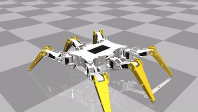
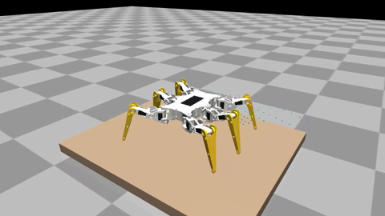

# Robot dog and hexapod physics simulation (MuJoCo)

MuJoCo models of the ESP32 small robot dog and the hexapod for testing motion
code before it goes on the real robots. Python, `pip install -r requirements.txt`.
The hexapod has [its own section](#hexapod) below; everything else is about the dog.

| | |
|---|---|
|  |  |
| Standing in the neutral pose, built from the printed STL parts | Trotting forward, driven by the firmware's own gait and IK (`lib/robot_core`) |
|  |  |
| Side view | Front holder: alpha servo gear and the 2:1 shoulder gear sector, hip-pitch servo in its bracket |

## Quick start

Needs Python 3.9+, a display for the viewer, and a C++17 compiler for the
firmware bridge (built automatically on first use): `g++` on Linux
(`sudo apt install g++`), Xcode command line tools on macOS
(`xcode-select --install`), MinGW-w64 `g++` on Windows (untested; WSL works
like Linux). Set `CXX` to pick another compiler.

```
git clone -b development https://github.com/SovGVD/esp32-legged-robots-core.git
cd esp32-legged-robots-core/sim
python -m venv .venv
source .venv/bin/activate            # Windows: .venv\Scripts\activate
pip install -r requirements.txt
python -m pytest -q tests            # checks everything works, builds the firmware bridge
python examples/drive.py             # viewer + control window: drive with WASD/arrows or an Xbox pad
python examples/drive.py --hexapod --terrain bridge   # drive over a ramp and a deck with gaps, ToF on
```

`drive.py` runs the real firmware gait (lib/robot_core) on the sim; the
controls are in the table under "Manual control" below. To just look at the
model, run `python -m mujoco.viewer --mjcf models/dog.xml`. Linux and Windows
(macOS isn't supported).

## Commands

```
python -m pytest -q tests            # 80 checks, ~60 s (builds the firmware bridges on first run)
python examples/drive.py             # drive the firmware by keyboard or Xbox 360 pad (needs a display)
python examples/trot.py --view       # Python demo trot in the viewer (needs a display)
python examples/trot.py --video trot.mp4
python examples/snapshot.py dog.png  # still images of the standing robot
python examples/build_model.py       # regenerate models/dog.xml after editing params
```

`models/dog.xml` can also be opened directly in MuJoCo's `simulate` app.

## What is modelled

| Part | Source | Notes |
|---|---|---|
| Geometry: hips at (±39.5, ±70.5, 0) mm, L2 = 51.9, L3 = 50, neutral foot (±56, ±70.5, −80) | `model/dog/model.h`, checked against the STLs | The parts confirm all of these, including the "not sure" hip Y (see below) |
| Hip pitch axis level with the roll axis (`hip_pitch_drop` = 0) | STLs + photos (shoulder bracket) | Same as the firmware IK. The knob stays in `legsim/params.py` to try a misaligned build |
| 3 joints per leg: alpha = hip roll, beta = hip pitch, gamma = knee | firmware IK | Joint angles map 1:1 to firmware leg angles (see below) |
| Masses: torso 280 g, shoulder 20 g (incl. hip-pitch servo), upper leg 3.5 g, lower leg 16.1 g (incl. knee servo); total 438 g | STL volumes + datasheets | Centres of mass and inertias come from the placed STL parts and servo/battery boxes. A scale reading would only be a check |
| MG90D servo: 0.21 N·m stall, 0.10 s/60°, ~4° proportional band, 0.5° deadband, 50 Hz pulse latching, torque-speed line, rotor inertia, gear friction | datasheet + estimates | Hip roll gets the 2:1 gear: twice the torque, half the speed |
| Pulse → angle: `servoMainProfile` calibration table, `getHALAngle` with mid/ratio/inverse | `hal.cpp`, `servo.cpp` | The sim servo is assumed to follow the calibration exactly |
| IMU: accelerometer + gyro at the middle frame, body axes X right / Y forward / Z up | MPU9250 orientation in the IK comments | Optional Gaussian noise |
| Foot contacts: touch sensor per foot | — | Exposed but optional; the real robot has none yet |
| Looks: Gleb's printed parts (STL meshes) plus boxes for servos, battery and electronics | Thingiverse 4822059 | `models/meshes/`, placed by `legsim/assembly.py` |
| Collisions: torso box, battery box, leg capsules, 6 mm foot spheres, friction 0.8 | shoe STL | Hidden (geom group 3); no self collisions |

Every number in `legsim/params.py` is tagged with where it came from: `[code]`, `[stl]`, `[ds]` (datasheet) or `[est]` (guess, tune later).

## Printed parts (STL meshes)

The FreeCAD design (github.com/SovGVD/esp32-small-robot-dog-hardware) has the
parts but no assembly, so `legsim/assembly.py` places them from their
geometry. Each STL's origin turned out to sit on a joint axis:

| Part | What it shows |
|---|---|
| `leg_top` | servo hub holes 51.94 mm apart, exactly L2 |
| `leg_bottom` | knee servo pocket with the shaft ~50 mm from the foot ring, L3 |
| `legs_holder_part1/2` | roll bearings (12 mm) at x = ±39.5 on the roll axis; alpha servo gear at x = ±11 (28.5 mm centre distance, 2:1 with the shoulder sector) |
| `body` | 86.6 mm long; its ends meet the inner holder plates, which puts the hip pitch axis at y = ±70.4, so the "not sure" 70.5 is right |
| `shoulder_part2` | the U bracket lies in the plane of its gear sector and holds the hip-pitch servo centred on the roll axis, shaft pointing outward, so the pitch axis is level with the roll axis |

Estimated, not visible in the parts: where the hip-pitch servo sits in the
bracket (±1.5 mm), how leg_top / knee servo / leg_bottom stack sideways, and
the electronics/battery positions. Left legs use mirrored meshes, and the hind
holders and shoulders are the front ones turned around.

`models/meshes/` holds decimated copies made by `tools/prepare_meshes.py`
from the Thingiverse files (CC BY-NC, by the robot's author).

## Joint convention

The sim joints are zero with the leg straight down, and convert 1:1 to the
firmware's leg angles:

```
q_roll  = pi/2 - alpha   (+ = foot outward)
q_pitch = pi/2 - beta    (+ = upper leg backward)
q_knee  = pi   - gamma   (0 = straight leg)
```

`tests/test_kinematics.py` checks this both ways: a Python port of
`QuadrupedLegIK` is fed foot targets, and the MuJoCo model's feet land exactly
on them. It also round-trips leg angle → pulse → leg angle through the HAL for
all four legs with their `inverse` flags.

## Interfaces (for the firmware bridge)

`legsim.SimDog` exposes the robot the way the hardware layer sees it:

| Firmware side | SimDog |
|---|---|
| servo bus: pulse per channel (`leg*3 + joint`), 0 = off | `write_pulse(ch, us)`, `write_pulses(us[12])` |
| IMU: accel + gyro | `read_imu()` → `{"accel": m/s², "gyro": rad/s}` |
| contact sensors (optional, future) | `foot_contacts()` |
| loop timing | `step(seconds)`; firmware `LOOP_TIME` is 4.4 ms |

Plus helpers: `set_leg_angles()` (runs the HAL like `runServoHAL`),
`set_feet()` (Python IK port → HAL), `set_joint_targets()`, and ground truth
(`body_position_mm()`, `body_orientation()` in the firmware's pitch/roll/yaw
convention, `foot_positions_body_mm()`).

## Running the firmware in the sim

`legsim.FirmwareCore` runs the firmware's own motion code: `lib/robot_core`
(`MotionController`: GaitEngine, BodyKinematics, QuadrupedLegIK, plus the
servo HAL) with the dog's legs, servo profile and gait parameters from
`src/esp32-legged-robot/model/dog/model_data.h`. It is compiled with the host
C++ compiler into `sim/build/librobot_core_bridge.so` (`sim/bridge/`), rebuilt
automatically when any of those sources change, and called through ctypes.

```python
from legsim import SimDog, FirmwareCore
dog, fw = SimDog(), FirmwareCore()
fw.drive(dog, (0, 1, 0, 0, 0, 0), duration=3.0)   # forward at full speed for 3 s
```

Each tick is `rc_update(dt, command, imu) -> pulses[12]`, the same as
`updateMotion()` + `servoSet()` on the robot, then `SimDog.write_pulses()`.
The command is `LR_moveVector`: move x (+ right), y (+ forward), z, rotate
pitch, roll, yaw (+ turns right), each in [-1, 1], like the web client.
The IMU reading is the simulated accelerometer and gyro run through the
firmware's own `TiltEstimator` (`fw.imu_angles(dog)`); it feeds the IMU
leveler, which is off unless `fw.set_leveling(True)` (or the model's
`HORIZON_LEVEL`).
`fw.select_gait("walk")` picks the dog's statically stable walk
(`GAIT_PARAMS_WALK`), `fw.support_margin()` reports how far the centre of
mass is inside the support polygon, and `fw.tune_gait(...)` /
`fw.set_stability_gain(...)` change timing and shift for experiments.

`tests/test_firmware.py` checks that the C++ IK + HAL produce the same
pulses as the Python port, that the firmware stands, trots, strafes,
turns and stops in the sim, and that the static walk keeps the centre of
mass inside the triangle and tilts less than the same walk without the
shift, and that leveling takes out most of an 8° slope (gravity tilted)
without rocking the robot on flat ground.

### Manual control

```
python examples/drive.py                                  # dog, flat floor
python examples/drive.py --hexapod                        # hexapod
python examples/drive.py --terrain rubble                 # rough gait, foot switches + ToF map
python examples/drive.py --hexapod --terrain gaps --sensing tof
python examples/drive.py --terrain bridge --sensing none  # open loop, like the real robots today
```

`--terrain` takes any scene from "Rough ground" below (flat, bumps, rocks,
rubble, bars, step, drop, gaps, bridge, course), `--height` the obstacle
height, `--sensing` none / contacts / tof / both (default both with a
terrain), `--gait` the starting gait (rough with a terrain). The ToF sensors
show as purple boxes with orange view cones and blue zone hits, and the
control window says "GAP AHEAD: stopped" while the robot waits at a gap it
can't step over (let go of the stick or steer away).

`python examples/drive.py` opens the MuJoCo viewer and a small "robot
control" window (`pip install pygame-ce`; if plain `pygame` is also installed, `pip uninstall pygame` first, they share the `pygame` module). Focus that window for the keyboard:

| Keyboard | Xbox 360 pad | Action |
|---|---|---|
| W / S, Up / Down | left stick up / down | forward / back |
| A / D | left stick left / right | strafe |
| Q / E, Left / Right | right stick X | turn |
| I / K, J / L | hold LB + right stick | tilt body (pitch, roll) |
| Shift | | slow (40 %) |
| G | Y | switch gait while standing: trot / static walk / rough (hexapod: tripod / rough) |
| R | Back | reset robot |
| P | Start | pause |
| Esc | | quit |

Keyboard and pad add up. Any pad SDL knows as a game controller works
(Xbox 360/One, most others). Linux and Windows.

## Hexapod

| | |
|---|---|
|  |  |
| Neutral stance, built from Gleb's printed parts | Walking forward, driven by the firmware's own gait and `HexapodLegIK` |

```
python examples/drive.py --hexapod             # drive it by keyboard / Xbox pad (needs a display)
python examples/hexapod_walk.py                # scripted walk, prints distance, tilt, servo load
python examples/hexapod_walk.py --video walk.mp4
python examples/hexapod_legtest.py             # does every servo turn the way the firmware expects?
python examples/hexapod_legtest.py --video legtest.mp4   # or --view, --leg RF
python examples/snapshot.py hexapod.png --hexapod
python -m pytest -q tests/test_hexapod.py
```

`models/hexapod.xml` opens in MuJoCo's `simulate` app. In code:

```python
from legsim import FirmwareCore
from legsim.hexapod import SimHexapod
fw = FirmwareCore(model="hexapod")             # builds sim/build/librobot_core_bridge_hexapod.so
robot = fw.place(SimHexapod())
fw.drive(robot, (0, 1, 0, 0, 0, 0), duration=3.0)   # forward, full speed (400 mm/s), 3 s
```

`SimHexapod` has the same interface as `SimDog` (`write_pulses`, `read_imu`,
`set_leg_angles`, `set_feet`, ground truth) with 18 channels, `leg*3 + joint`
in the firmware leg order LF, LM, LR, RF, RM, RR (not the PCA9685 channel;
the second board at 0x42 only matters on hardware). `joint_torque_ratio()`
says how close each servo is to stall.

| Part | Source | Notes |
|---|---|---|
| Coxa axes at (±46, ±80) and (±57.5, 0) mm, coxa 35, femur 55, tibia 110 | `model/hexapod/config.h`, checked on the STLs | Bearing holes in the body, the coxa's yaw and femur axes, the knee axis and tibia tip all land on the firmware numbers |
| Body origin at the femur axis height, 28.7 mm above the body bottom | STLs | Standing height 67.3 mm (IK), 38.6 mm ground clearance |
| Gears: coxa 2:1, femur 2:1, tibia 1.5:1 | STLs (tooth tips: 18-tooth servo gears, 36-tooth coxa sector and femur gear, 27-tooth tibia gear, module 1) | Same as the HAL ratios in `model_data.h` |
| Servos: coxa servos upside down in the body bottom, femur servo in the coxa, tibia servo in the femur | servo screw holes in the STLs | Shafts placed at the gear centre distances (27 and 22.5 mm) |
| MG90S clone: 0.176 N·m stall, 0.10 s/60° | datasheet at 4.8 V | Same servo model as the dog otherwise |
| Pulse → angle: hexapod `servoMainProfile` (0-180°, 590-2200 µs) | `model_data.h` | |
| Masses: ~892 g total | STL volumes + datasheets + estimates | Body halves 124 g, 18 servos 241 g, 2x18650 + holder 106 g, electronics 47 g; per leg coxa 31, femur 29, tibia 19 g |
| Right legs mirrored, left legs turned | photos | All femur and tibia gears face forward, like on the real robot |

The STLs (`tmp-hexapod-*`, `tmp-Femur`, servo gear) are the ones that match
the photos; `tools/prepare_hexapod_meshes.py` decimates them into
`models/meshes/hexapod/`. The `hexapodv2` body in the FreeCAD file is a
newer, different body and isn't used. Estimated: the electronics and battery
positions, the IMU at the body centre, and everything that needs a scale.

Stance (`model/hexapod/config.h`): feet 118 mm out from the coxa axis and
95 mm down, so the femur is 11.6° up and the tibia ~15° off vertical. The first
model stance (160 mm out, 67 mm down) put the femur servos at their limit;
a lower body or a higher knee (femur more than ~12° up) runs into the femur's
45° range as soon as a foot lifts 30 mm.

First findings (with the estimated 892 g at ~5 V):

* The firmware gait walks it as configured (tripod, 0.3 s cycle): about
  1.1 m forward in 3 s (400 mm/s), ~300 mm/s strafing, turning at 0.75 rad/s,
  with under 2° of tilt and no IK failures.
* Top speed with MG90S servos (tripod, duty 0.5): forward tops out at about
  550 mm/s and sideways at ~380 mm/s; past that the servos only lag more
  (femur/tibia 23°/23° at 400 mm/s, 38°/62° commanding 800). The old
  default (duty 0.75, 75 mm/s) gave each swing only 100 ms.
* Femur servos use ~30 % of stall torque standing and stay below it while
  walking (with the old wide stance: 46 % standing, saturated 10 % of the
  time on three legs, 5-9 mm of sag).
* Servo directions: see below.

### Servo directions (leg test)

The hexapod sim turns each joint the way its servo is mounted, not the way
the firmware's `inverse` flags say: `legsim/hexapod/assembly.py` knows which
side each servo shaft points to, that every gear pair reverses the rotation,
and that a longer pulse turns an MG90 counter-clockwise seen from the shaft
(taken from the dog's working config). The right legs are mirror images of
the left (all gears face forward, as in the photos). So a wrong flag in
`model_data.h` makes a leg move the wrong way in the sim, like on the robot.

`examples/hexapod_legtest.py` hangs the robot in the air and, one leg at a
time, moves the foot up, out, forward and turns the leg around its coxa
through the firmware's own IK and HAL (`FirmwareCore.leg_test_pulses`). It
prints OK/WRONG per move, the joints that turned against the IK's plan and
the flags to flip. Edit `model_data.h` and run it again; the bridge rebuilds.
With the original flags (none inverted) it reports the tibias on LF, LM, LR
and the femurs on RF, RM, RR; with the flags in this model all 24 moves pass.
The assumptions it rests on (shaft sides, servo direction) are the
`SHAFT`/`SERVO_TURNS_CCW` constants in `assembly.py`: if the robot disagrees,
fix those and the test tells you the flags.

### What-if: other servos

`examples/hexapod_servo_compare.py` runs the firmware tripod on the same legs,
stance and weight with PTK 7465MG servos driving every joint directly (no
gears, 180° per joint), next to the current MG90S + gears:

```python
from legsim.hexapod import SimHexapod, direct_drive, ptk_7465mg
robot = fw.place(SimHexapod(params=direct_drive(servo=ptk_7465mg(volts=7.4, frame_hz=333))))
fw.drive(robot, (0, 1, 0, 0, 0, 0), 3.0, ideal_servos=True)
```

`ptk_7465mg(volts, frame_hz)` takes the datasheet torque and speed at 5.0-8.4 V.
The firmware HAL still has the geared ratios, so `ideal_servos=True` sends
its leg angles straight to the joints instead of its pulses; its joint limits
also stay the geared ones (coxa ±45°), so longer steps and faster turns that
direct drive would allow aren't used.

Findings (datasheet values, tripod, 0.3 s cycle):

| | MG90S + gears | 7465MG 6 V | 7465MG 7.4 V | 7465MG 7.4 V, 333 Hz |
|---|---|---|---|---|
| Standing femur load (of stall) | 30 % | 24 % | 20 % | 20 % |
| Lag at 400 mm/s forward | 23° | 16° | 15° | 2-3° |
| Clean top speed forward / sideways, mm/s | ~550 / ~330 | ~700 / ~380 | ~700 / ~400 | ~900 / ~520 |

At 50 Hz frames (the PCA9685 now) the stronger servos jump to each new target
and the body rocks 3-5°, so a higher voltage gains little. The 7465MG reads
up to 333 Hz pulses, and the PCA9685 can run that fast (2500 µs fits in 3 ms).

## Rough ground: foot switches and ToF sensors



```
python examples/terrain_walk.py                              # dog, obstacle course, foot switches + ToF
python examples/terrain_walk.py --hexapod --terrain step --sensing tof
python examples/terrain_walk.py --hexapod --terrain bridge --sensing tof    # ramp, deck with gaps, ramp down
python examples/terrain_walk.py --compare                    # every scene x sensing mode, a table
python examples/terrain_walk.py --hexapod --terrain bars --video bars.mp4   # ToF sensors as purple boxes, view cones orange, zone hits blue dots
python -m pytest -q tests/test_terrain.py
```

The terrain code is firmware code (`lib/robot_core`), off unless enabled,
so the real robots keep walking open loop until sensors are fitted:

* **Foot switches** (`GaitParams.useContactSensors`, `leg.sensor.onGround`):
  a foot that hasn't touched down when its swing time is over keeps
  reaching down (`searchDepth`), a foot that touches down early stays there,
  and a standing foot whose switch opens (slid off an edge) reaches down
  again. Each leg remembers the height it stood on and aims its next step there.
* **ToF terrain map** (`TerrainMap`, `TOF_SENSORS` in `model_data.h`): each
  zone of a multizone ToF (VL53L5CX 8x8, or a VL53L1X with ROI zones) is a ray
  from the sensor; its hit goes into a 40x40 height grid around the robot in
  the gait's odometry frame (dog: 12 mm cells, hexapod: 15 mm). A swing aims
  at the mapped height of its foothold, goes up first and then across, at
  least `clearance` above the highest mapped point on its way, and a foothold
  on an edge moves along the step onto flat ground.
* The **body height** follows the average ground under the feet, and the
  **IMU leveler** keeps the body level: in terrain mode the bridge doesn't
  hold it during a trot, and the scenarios turn leveling on with any sensing.
  The unplanned body tilt (IMU) also corrects the measured touchdown heights
  (`GaitEngine::setTilt`).
* **Gaps**: a foothold keeps `gapMargin` (20 mm) away from ground that drops
  away (lower than its own by more than `maxStep`) and from unseen cells
  between known ground (the ToF can't see into a narrow trench or under a
  cliff edge, it sees the far wall). A foothold in a gap moves along the step
  (`footholdShift`) onto solid ground. When there is none, and none further
  on within one step either, the gap is too wide: the swing puts the foot back
  where it lifted off and the gait blocks the command in that direction
  (`GaitEngine::isBlocked()`, `blockedDirection()`) until the stick stops
  pushing that way. Turning or walking back works while blocked.
* **Map pose**: the body tilt the map uses matters at a gap edge (1 deg is
  4 mm at 250 mm). Hexapod: the leveler's commanded tilt plus the IMU's
  unplanned tilt with the slow walking bias (1-2 deg, 1.5 s filter) taken
  out and smoothed over 0.3 s; with the raw IMU its mapped floor crept up
  10-20 mm in 10 s of walking (the leveler follows the bias) and it stepped
  onto nothing. Dog: the raw IMU; its trot rocks faster than that filter and
  the filtered tilt cost it the 20 mm step. Cells age only while walking, so
  a robot standing at a gap still remembers it. (`rc_set_map_tilt_mode` in the
  bridge switches it for experiments.)
* Not wired on the robots yet: `motion.cpp` doesn't read switch pins or a ToF
  driver, so nothing changes on hardware. When sensors are fitted it needs to
  set `leg.sensor.onGround`, feed `TerrainMap::addReading` with the map pose
  above, tick the map only while the gait is active, call
  `gait().setTerrain(...)` / `setTilt(...)`, not hold the leveler, and show
  `isBlocked()` to the operator (telemetry / web UI), the way
  `sim/bridge/robot_core_bridge.cpp` does.
* `GAIT_PARAMS_ROUGH` (dog and hexapod): a slower gait with a longer swing.
  The servos can't lift a foot 30-40 mm in the normal 100-150 ms swing; the
  foot lags and hits the edge.

`TERRAIN_PARAMS` and `TERRAIN_MAP_PARAMS` in each `model_data.h` hold the
numbers. Sensor mounts (simulated, nothing is fitted yet): dog, one 8x8 ToF on
the nose looking 40 deg down; hexapod, two on the front turned 20 deg left and
right, 35 deg down.

In the sim (`legsim/terrain.py`, `legsim/tof.py`): obstacles are static boxes
(bumps, rocks, rubble, bars, step, drop = walk off a platform); a foot switch is
pressed when the ground pushes the foot up with more than 0.3 N (vertical
part only, so pushing against the side of an obstacle doesn't press it); the
ToF casts one ray per zone at 15 Hz with 2 mm + 1 % noise against the
terrain (not the robot). `FirmwareCore.set_terrain(contacts, tof)` switches
the modes, and `legsim.scenario.run()` walks a robot over a scene and
measures it.

Findings (rough gait, full stick, 8 s dog / 6 s hexapod; `--compare`):

| | open loop | switches | ToF | both |
|---|---|---|---|---|
| Dog, 20 mm step | stuck at the edge, 127 mm | 310 mm | **641 mm, up** | **705 mm, up** |
| Dog, 10 + 20 mm bars | 434 mm | 452 mm | **696 mm** | 425 mm |
| Dog, 12 mm bumps | 612 mm, tilt 2.1 deg | 683, 4.2 | 678, 3.2 | 659, 2.3 |
| Hexapod, 30 mm step | 548 mm, tilt 2.8 deg | 414, 3.7 | **686, 0.8** | **690, 0.9** |
| Hexapod, 15 + 30 mm bars | 462 mm | 500 | **627** | **668** |
| Hexapod, 18 mm bumps | 674 mm, tilt 1.4 | 677, 1.5 | 701, 1.2 | 703, 1.6 |
| Hexapod, 22 mm drop | 689 mm, tilt 2.1 | 680, 2.9 | 683, 1.1 | 694, 1.4 |
| Dog, rubble up to 20 mm | 556 mm, tilt 2.7 | 610, 4.3 | 560, 4.2 | 564, 4.4 |
| Hexapod, rubble up to 30 mm | 683 mm, tilt 1.4 | 653, 1.2 | 696, 1.4 | 666, 1.4 |

* The ToF map does most of the work: with it the dog climbs a 20 mm step its
  open-loop trot can't, and the hexapod walks up 30 mm level instead of
  stumbling up it.
* Foot switches alone can only feel an obstacle after hitting it. They help
  on small bumps and holes, not on anything taller than the step height; on
  the dog's trot (two legs down) they add some rocking.
* Dense rubble (`rubble()`: overlapping blocks 10-80 mm across, mixed
  heights, about half the ground covered) gains little from sensing: the
  rough gait's step height already clears most of it, and the blocks are
  smaller than the map can resolve well. The hexapod
  walks it the same in every mode (with fewer leg knocks with ToF); the dog,
  at its height limit, rocks more with sensing (mean tilt ~4 deg vs 2.7).
  Lowering the swing on high legs (apex over the mean ground) helped here but
  broke the step climb, so it is not in.
  `FirmwareCore.tune_terrain(...)` changes `TERRAIN_PARAMS` for experiments.
* Limits: the hexapod's femur servos (45 deg each way, 2:1 gear) run out
  above ~30 mm obstacles, the dog's legs (80 mm, reach 102) around 20 mm.
  Higher needs a taller stance or longer legs, not more sensing.
* **Gaps and the bridge** (`gaps()`: trenches in a raised floor, narrow to
  too wide; `bridge()`: a ramp up onto a narrow deck with gaps, a ramp down;
  ToF, 3 runs each, `scenario.run(..., steer=True)` on the bridge):

  | | open loop | ToF |
  |---|---|---|
  | Hexapod, 40 mm gap | a foot falls in, tilt ~28 deg | **steps over, tilt 4 deg, 3/3** |
  | Hexapod, 60 mm gap | falls in | steps over 2/3 (one run tilts 25 deg) |
  | Hexapod, 90 mm gap | falls in | stops at the edge 1/3, a foot catches the edge the other times |
  | Hexapod, 250 mm gap | falls in | **stops at the edge** (test) |
  | Hexapod, bridge (40 + 55 mm gaps) | falls in, tilt 29 deg | crosses, 1170 mm; 2/3 runs tilt over 20 deg once |
  | Dog, 25 mm gap | falls in | gets across 1/3, tips a leg in 2/3 |
  | Dog, 40 mm gap | falls in | stops at the edge, tips a leg in 2/3 |
  | Dog, 60 mm gap | falls in | **stops at the edge, 3/3** |
  | Dog, bridge (25 + 35 mm gaps) | falls in | gets onto the deck (970 mm), tips over 20 deg in 2/3 |

  The hexapod (three feet down, slow tripod) handles gaps; the dog's trot
  (two feet down) is fragile at an edge: its odometry slips 20-40 mm per
  metre, so the map is that far off, and one misplaced foot tips it.
  Gaps narrower than two map cells (dog 24 mm, hexapod 30 mm) are hard to
  see; the feet step over them or onto the edge.
* Odometry: the map lives in the gait's odometry frame. When a foot gets
  stuck the robot falls behind its odometry and the map slides with it;
  cells are forgotten after `maxAge` (dog 10 s, hexapod 6 s).

## Plan

1. **Model (done).** Parametric MJCF, servo and IMU models, tests that
   pin the joint convention to the firmware IK and HAL.
2. **Firmware bridge (done, see above).** Build `lib/robot_core` (Arduino-free since the
   C++ module refactor) for the host as a small shared library with a C API:
   `rc_init(config)`, `rc_update(dt, command, imu) -> pulses[12]`. Load it
   from Python with `ctypes` and drive `SimDog.write_pulses` from it at the
   4.4 ms loop rate. Then the sim runs the real `GaitEngine`, IK and balance
   code, not the Python demo gait. The sim side won't need changes: the C API maps onto
   `write_pulses` / `read_imu`.
3. **Scenario tests.** Run in CI on the host: stand, trot forward/turn,
   obstacles and steps (done, see "Rough ground"), push recovery, slope. Check distance, drift,
   max tilt, and servo torque saturation (the sim can report how close each
   servo is to stall, which hardware can't).
4. **Calibrate against the real robot** when convenient: one video of a trot
   in place and a forward trot, and optionally a weight. Tune masses, servo
   kp/deadband and foot friction until drift and tilt match.

## Known limits and first findings

* Masses are estimates from STL volumes (20 % infill); inertias come from
  the meshes as shells, which suits printed parts.
* **Hip geometry:** the hip pitch axis is level with the roll axis and the
  leg plane is within ~2 mm of it sideways, so the firmware IK's L1 = 0 holds.
  `hip_pitch_drop` can model a pitch axis below the roll axis if a build
  differs (the sim then stands that much taller than the IK expects).
* Servo voltage is assumed ~5 V (datasheet 4.8 V values).
* **Body wobble while trotting** came from the servos, not the gait plan. An
  MG90D turns ~10 rad/s (the hip roll, with its 2:1 gear, ~5 rad/s) and reads
  the pulse at 50 Hz. A swing that asks for more lands the foot 50-100 ms late,
  the body stands on one diagonal that much longer and tips over it. The dog's
  gait keeps within that: 15 mm step height, and `maxSideSpeed` = 50 mm/s
  limits strafing plus turning (the hip roll joints do all the sideways work).
* The firmware trot's backward drift (~13 mm/s in place, ~60 mm/s strafing)
  came from the centre of mass sitting ~5 mm behind the middle of the feet;
  `centerOfMass` in the gait params now moves the body over it.
* **Trotting in place drifts backward** in the sim (about 30 mm/s with the
  Python demo trot, duty 0.5, 15 mm step height). The most likely cause is stance-leg
  compliance: the hobby servos sag under load, and with all knees bending the
  same way the sag shifts the body backward a bit every step. It shrinks
  with lower steps or more leg overlap (duty 0.6). Worth checking whether the
  real robot does the same, since that is the first calibration point.
