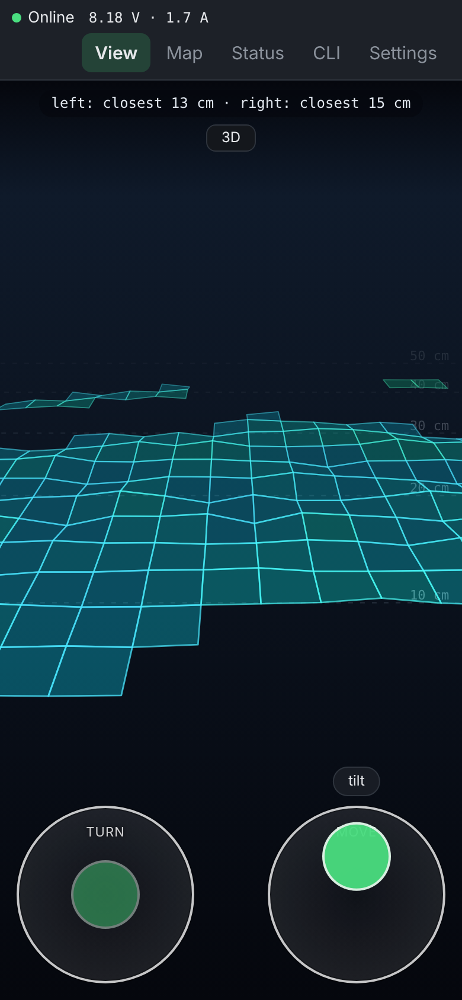
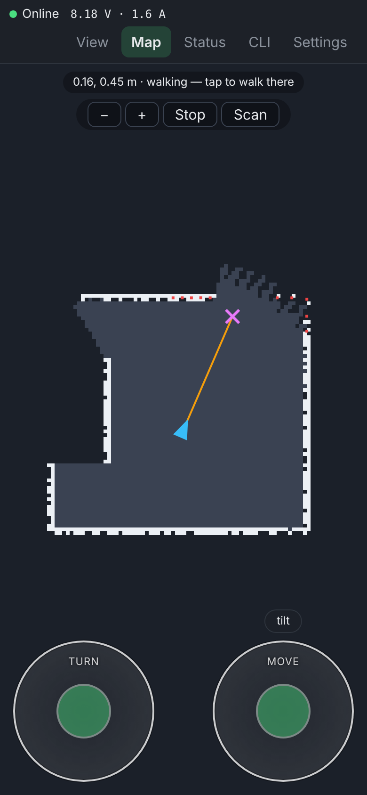
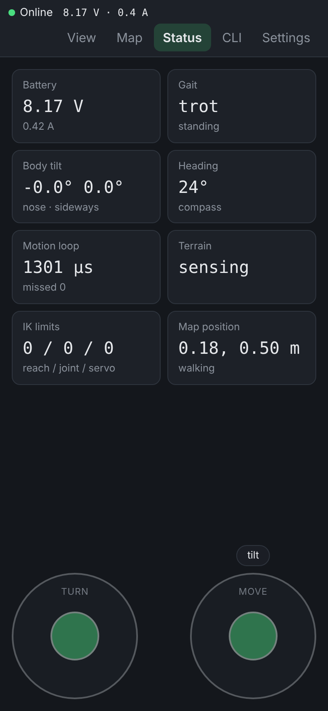
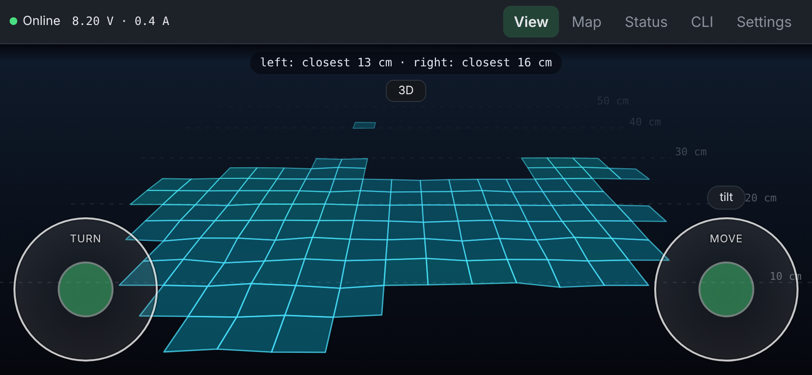

# Robot web interface

The control page served by the robot. Like a game HUD: one view fills the
screen and tabs switch it (View: ToF first person / 3D / grid, Map: tap to
walk, Status: telemetry cards, CLI, Settings), a thin bar on top shows the
connection and battery, alerts (gap ahead, battery low, another device took
control) float over every tab, and the two round thumb sticks stay on top of
all of it, so you can drive whatever you are looking at. It is plain TypeScript (no UI framework),
built with [Vite](https://vite.dev) into a single HTML file, gzipped and
embedded into the firmware as `src/esp32-legged-robot/web/index.html.gz.h`.

| Drive (ToF first person) | Map (tap to walk) | Status |
| --- | --- | --- |
|  |  |  |



Screenshots are from the demo build (`npm run build:demo`), which has a mock
robot inside the page.

Requires Node.js 22.18 or newer.

## Commands

| Command | What it does |
| --- | --- |
| `npm ci` | install dependencies from the lock file |
| `npm run dev` | dev server with hot reload and a mock robot (no ESP32 needed) |
| `ROBOT=192.168.4.1 npm run dev` | dev server that talks to a real robot |
| `TOF=1 npm run dev` | number of ToF views in dev (default 2; dog 1, hexapod 2) |
| `TOF_NAV=0 npm run dev` | mock map acts like a lidar (default: ToF room scans, Scan button) |
| `npm run build:demo` | `dist-demo/index.html`: one file with the mock robot inside, opens without a robot or server (`#dog` for 1 ToF) |
| `npm test` | protocol unit tests |
| `npm run build` | type-check, build and write `index.html.gz.h` for the firmware |

Commit the regenerated `index.html.gz.h` together with the web changes, the
firmware build does not run Node. The build fails if the gzipped page grows
over 16 KB (see `scripts/embed.mjs`).

The dev server listens on the local network too, so you can open it from a
phone. `?ws=ws://<host>/ws` in the page URL overrides the robot address.

## Layout

```
index.html            page markup; /c.js is the config generated by the firmware
src/main.ts           wiring: send loop, telemetry, failsafe on hidden tab
src/protocol.ts       binary websocket protocol (keep in sync with the firmware)
src/connection.ts     websocket with reconnect
src/joystick.ts       round pointer-event thumb stick (multi-touch)
src/demo.ts           demo build only: in-page socket to the mock robot
src/cli.ts            robot CLI terminal
mock/sim.ts           mock robot: drives around a two room flat, ToF rays, map, battery
mock/robot.ts         mock robot behind a websocket for the dev/preview servers
scripts/embed.mjs     dist/index.html -> gzip -> C header
test/                 node:test unit tests
```

## Protocol

See the header comment in `src/protocol.ts`. In short: the page sends a 14
byte move package (`M`) every 50 ms, which also feeds the firmware failsafe;
`T` asks for telemetry once a second; `C` carries CLI text both ways. The
firmware allows one controlling client: when another device connects, this
page shows "Another device took control" and stops reconnecting until you tap
"Take control".
